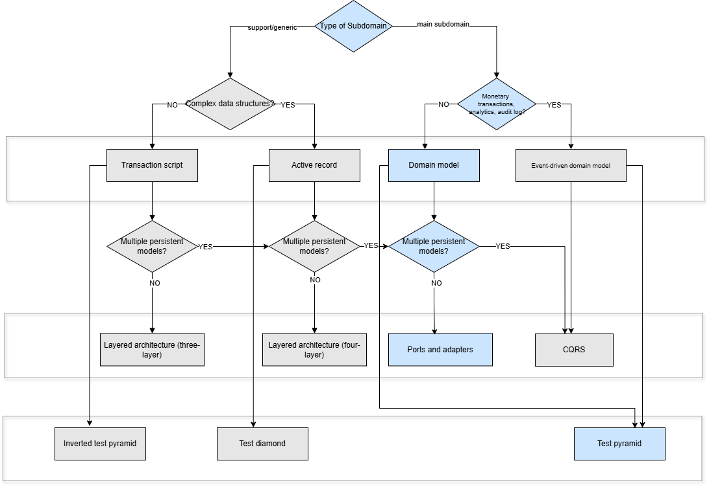
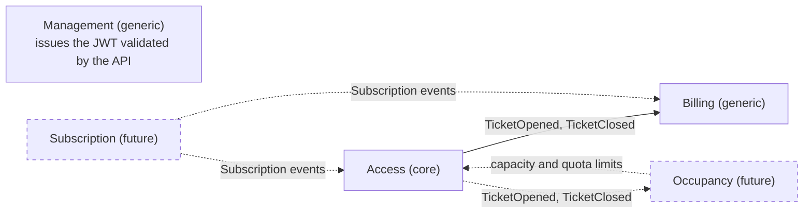

# 🅿️ NeoParking - DDD Approach

> Applying Domain-Driven Design (DDD) in practice with a pragmatic and objective approach.

---

## 📖 Table of Contents

1. [About](#1-about)
2. [Domain Description](#2-domain-description)
3. [General Assumptions](#3-general-assumptions)
4. [Process Discovery](#4-process-discovery)
5. [Bounded Contexts](#5-bounded-contexts)
6. [Project Structure and Architecture](#6-project-structure-and-architecture)
7. [Context Map](#7-context-map)
8. [Events](#8-events)
9. [Authentication & Authorization](#9-authentication--authorization)
10. [Architecture Tests](#10-architecture-tests)
11. [DevSec](#11-devsec)
12. [.NET](#12-net)
13. [Tests](#13-tests)
14. [How to Contribute](#14-how-to-contribute)
15. [References](#15-references)

---

## 1. About

NeoParking is a domain-driven sample project that aims to model a real-world parking operation using strategic and tactical DDD principles.
It highlights architecture design, domain modeling, and implementation choices aligned with a real business case.

---

## 2. Domain Description

NeoParking is a conventional parking lot that seeks to modernize its operations. Its main differential is the human service and the trust it offers, but it faces challenges with manual ticket management and lack of visibility about spot availability. The vision is to integrate technology to optimize processes, improve customer experience, and ensure efficiency while maintaining the human touch that differentiates it.

The main revenue of NeoParking comes from two sources: walk-in customers in the "free zone," who pay for occasional use, and monthly subscribers who guarantee a stable and predictable income. The current operation management is a combination of human supervision and manual processes.

---

## 3. General Assumptions

### Business Assumptions

**Payment Models Volatility**: Subscription, monthly, and daily payment models are subject to frequent changes due to market conditions and business strategy adjustments. However, the **hourly payment model remains the core stable revenue stream** and serves as the foundation for all pricing calculations.

**Pricing Strategy**: The hourly model is the base unit for walk-in customers. Subscribers pay a fixed price through their subscription, with no discount on hourly rates.

### Technical Assumptions

**Scalability**: System designed for medium-scale operations (1000+ daily transactions)
**Availability**: 99.5% uptime requirement with graceful degradation
**Data Consistency**: Eventual consistency acceptable between contexts
**Integration**: REST APIs for external systems, integration events for communication between contexts

---

## 4. Process Discovery

As an initial step, I decided to understand a little more about the business domain using user story and event storming. Through the big picture, some information that was hidden in the process was made explicit.

[Big Picture](https://miro.com/app/live-embed/uXjVJXjg3VM=/?focusWidget=3458764636230014271&embedMode=view_only_without_ui&embedId=230222431067)

### Nouns (specific to NeoParking domain)
- Owner
- Client
- Subscriber driver
- RFID
- Ticket
- Fee
- Parking operator / Manager
- Available parking spots
- Subscription plan
- Payment

### Verbs (with context)

- Register entry (vehicle/subscriber entry recorded)
- Present RFID or QR Code (at entry for identification)
- Register exit (vehicle/subscriber exit recorded)
- Validate ticket or identification (at exit)
- Control duration of stay (for fee calculation)
- View available parking spots (in real-time)
- Monitor parking occupancy (for operational decisions)
- Manage subscription plan (renew, cancel, update)
- Update access permissions (based on subscription status)
- Process payment (for subscriptions or one-time tickets)

### Domain language

- **Operator** — An internal system user (Operator, Admin, or Owner) who authenticates to operate any module of NeoParking. Distinct from the parking *Client* — this is staff, not a customer.
- **Client** — A customer who owns a vehicle and has the right to use the parking service. Can be either a casual user (pay-per-use) or a registered subscriber. Associated with tickets, payments, and identification methods like RFID.
- **Subscriber** — A special type of client with an active subscription plan (e.g., monthly pass). Typically has extended privileges such as automated entry and exit via RFID, and is charged through a recurring fee rather than per visit.
- **Ticket** — A representation of a parking session. Includes entry time, vehicle identification, and assigned parking area. Can be physical (printed with QR code) or digital.
- **Fee** — The monetary charge applied to a parking session. Usually calculated based on duration, but may include special pricing rules, grace periods, or penalties.
- **RFID** — A Radio Frequency Identification tag assigned to a vehicle or user. Allows automated access control by detecting and identifying subscribers at entry and exit points without manual intervention.

---

## 5. Bounded Contexts

All contexts are modules of the same monolith, each with its own MySQL schema.

### Access

Owns the relationship with the parking's customers and the parking session: clients, their vehicles, and tickets (entry and exit). Publishes integration events through the outbox so other contexts can react without coupling to Access's internals.

Each ticket has a unique, opaque code (20 hexadecimal characters from a cryptographic source), the same for a printed or a digital ticket. A ticket closes by id, by code, or by plate when it was lost; the exit by plate requires a reason and records the reason and the operator from the token. Whichever method is used, a ticket publishes a single `TicketClosed`, even when two exits run at the same time.

A client is an `Individual` with a CPF or a `Company` with a CNPJ, which may be alphanumeric. Walk-in drivers have no document. Foreigners without a CPF are out of scope for now.

Vehicle plates and client documents are globally unique: each plate has a single responsible client, and there is no dedicated transfer flow, so a plate is removed from the old client and registered on the new one. The client is the one responsible for the vehicle at the parking; ownership is not verified.

Documents stay encrypted in the database and masked in every response (`***.444.777-**`, `**.***.345/01DE-**`). See [Client documents](#client-documents).

### Billing

Owns pricing and fees. The Owner defines versioned pricing policies; Billing keeps its own view of each ticket, built from Access's events, and freezes the fee when the ticket closes.

### Management

The **gatekeeper** of the system. Owns authentication and authorization for every internal user (`Operator`, `Admin`, `Owner`) who needs to operate any other module. No business module is reachable without a token issued by Management's login.

- **Owner** — single, unique account, created once via a bootstrap endpoint. Cannot be demoted, deactivated, or duplicated.
- **Admin** — created by the Owner; can create and manage Operators.
- **Operator** — day-to-day staff account; cannot create or manage other accounts.

Issues JWT tokens on successful login, validated by the API on every protected endpoint. Modules do not call Management.

> Spot availability (Occupancy), subscriptions, payments, and RFID/QR credentials are not implemented yet. See [the product evolution spec](docs/specs/product-evolution.md).

---

## 6. Project Structure and Architecture

The project follows a **Modular Monolith** with **Domain-Driven Design** tactical patterns. Each Bounded Context is a single class library — layers are separated by folders, not by projects, enforced through architecture tests. Tests live in a sibling `tests/` folder, fully decoupled from production code — no test assembly is ever published or shipped.

📋 **[View Complete ADRs →](docs/architecture-decisions.md)**



### Solution Structure

```
NeoParking-DDD-dotnet/
├── src/
│   ├── Shared/
│   │   └── NeoParking.Shared.Kernel/        # Primitives, contracts and the shared outbox
│   │       ├── Configuration/               # .env loader, MySQL password handling
│   │       ├── Events/                      # IDomainEvent and the integration event contracts
│   │       ├── Exceptions/                  # Mapped to HTTP status codes by the API
│   │       ├── Observability/               # ICorrelationIdProvider
│   │       ├── Outbox/                      # OutboxMessage, OutboxRepository, OutboxProcessor
│   │       ├── Persistence/                 # Unique-index conflict handling
│   │       └── Primitives/                  # Entity, PagedResult
│   │
│   ├── Modules/
│   │   ├── Access/                          # Single project per Bounded Context
│   │   │   ├── AccessModule.cs
│   │   │   ├── Domain/                      # Client, Vehicle, Ticket; Document, Plate, PhoneNumber
│   │   │   ├── Application/                 # ClientService, TicketService, ports, DTOs
│   │   │   ├── Infrastructure/mysql/        # EF Core, repositories, outbox
│   │   │   └── Migrations/
│   │   │
│   │   ├── Billing/
│   │   │   ├── BillingModule.cs
│   │   │   ├── Domain/                      # PricingPolicy, Ticket, Fee, FeeCalculator; Money
│   │   │   ├── Application/                 # PricingPolicyService, TicketService, event handlers
│   │   │   ├── Infrastructure/mysql/        # EF Core, repositories, outbox
│   │   │   └── Migrations/
│   │   │
│   │   └── Management/
│   │       ├── ManagementModule.cs
│   │       ├── Domain/                      # OperatorUser, OperatorRole; PasswordHash
│   │       ├── Application/                 # OperatorService, ports, contracts
│   │       ├── Infrastructure/              # BCrypt hasher; mysql/ with EF Core and repository
│   │       └── Migrations/
│   │
│   └── NeoParking.Api/                      # Entry point, endpoints and DI composition
│       ├── Endpoints/                       # Client, Ticket, Management and Billing endpoints
│       ├── Extensions/                      # Modules, auth policies, error handling, observability
│       ├── Middleware/
│       ├── JwtTokenGenerator.cs
│       ├── HttpCorrelationIdProvider.cs
│       ├── Program.cs
│       └── appsettings.json
│
├── tests/                                   # Decoupled from src/ — never shipped (see Tests)
├── scripts/mysql/                           # Schemas, grants, duplicate detection, outbox replay
├── docker-compose.yml
├── docker-compose.expose-db.yml
├── .env.example
└── Neoparking.sln
```

### Dependency Rules

Layers are folders inside each module's project; architecture tests enforce the direction.

```
NeoParking.Shared.Kernel          contains primitives, contracts and shared outbox; depends on EF Core and MediatR
NeoParking.{Access|Billing|Management}
  Domain                          → Shared.Kernel
  Application                     → Domain
  Infrastructure                  → Domain + Application
NeoParking.Api                    → Access + Billing + Management (endpoints and DI composition)
```

Bounded Contexts never reference each other's projects. They communicate only through integration events published to the outbox and defined in `Shared.Kernel/Events`: Billing reacts to `TicketClosedIntegrationEvent` without depending on `NeoParking.Access`.

### Module Registration Pattern

Each module exposes its services through an extension method, and `AddNeoParkingModules` is the only place that calls them:

```csharp
// Program.cs
builder.Services.AddNeoParkingModules(builder.Configuration);

// Extensions/ModuleExtensions.cs
services.AddAccessModule(configuration);
services.AddManagementModule(configuration);
services.AddBillingModule(configuration);
```

`InitializeNeoParkingDatabases` applies each module's migrations when the API boots.

---

## 7. Context Map

Solid lines exist in the code. Dashed lines and nodes are planned and do not exist yet.



- **Access → Billing:** Billing conforms to the event contracts Access publishes.
- **Management:** provides identity to every module through the JWT, not through module calls or events, so it has no arrows.
- **No consumer yet:** `ClientRegistered` (Access) and `PricingPolicyChanged` (Billing) are published, but nothing reacts to them.
- **Payments (future):** planned inside Billing, not as a separate context.

---

## 8. Events

### Integration Events (cross-BC, via outbox)

| Event | Published by | Consumed by | Purpose |
|---|---|---|---|
| `ClientRegisteredIntegrationEvent` | Access | No consumer yet | A new client exists |
| `TicketOpenedIntegrationEvent` | Access | Billing | Create Billing's view of the ticket |
| `TicketClosedIntegrationEvent` | Access | Billing | Calculate and freeze the fee |
| `PricingPolicyChangedIntegrationEvent` | Billing | No consumer yet | A pricing policy was defined or revised |

Access and Billing each own an outbox table and a background processor. A service writes the event to the outbox in the same transaction as its data. Every 10 seconds, the processor publishes pending messages in-process with MediatR, giving at-least-once delivery. Handlers are idempotent. Retries and replay are described in [Outbox retries and replay](#outbox-retries-and-replay).

---

## 9. Authentication & Authorization

Management issues JWTs on successful login (`POST /operators/login`). Tokens carry the operator's id (`sub`), email, and role, and are validated on every request by ASP.NET Core's JWT Bearer middleware.

### Endpoint protection

| Endpoint | Public | Any operator | Owner/Admin | Owner |
|---|---|---|---|---|
| `POST /operators/login` | ✅ | | | |
| `POST /operators/owner` | ✅ | | | |
| `GET /health` (status only: `200` or `503`) | ✅ | | | |
| `POST /operators` | | | ✅ Admin creates only Operator | |
| `GET /operators?page=&pageSize=` (at most 100 per page) | | | ✅ | |
| `GET /operators/{id}` | | | ✅ | |
| `POST /operators/{targetId}/promote`, `/demote` | | | | ✅ |
| `POST /operators/{targetId}/activate`, `/deactivate` | | | ✅ Admin acts only on Operator | |
| `POST /clients`, `GET /clients`, `GET /clients/{id}`, `PATCH /clients/{id}` | | ✅ | | |
| `GET /clients/{id}/document` | | | ✅ | |
| `POST /clients/{id}/vehicles`, `DELETE /clients/{id}/vehicles/{vehicleId}` | | ✅ | | |
| `DELETE /clients/{id}` | | | ✅ | |
| `POST /access/tickets`, `POST /access/tickets/{id}/exit` | | ✅ | | |
| `GET /access/tickets`, `GET /access/tickets/{id}` | | ✅ | | |
| `GET /access/tickets/by-code/{code}`, `POST /access/tickets/by-code/{code}/exit` | | ✅ | | |
| `POST /access/tickets/by-plate/{plate}/exit` (reason required) | | ✅ | | |
| `GET /billing/pricing-policies/active` | | ✅ | | |
| `GET /billing/pricing-policies/history`, `/effective-at` | | | ✅ | |
| `POST /billing/pricing-policies` | | | | ✅ |
| `GET /billing/tickets/fee-history` | | | ✅ | |
| `GET /billing/tickets/{id}` | | ✅ | | |

Without a valid token, a protected endpoint returns `401`; with an insufficient role, `403`.

In Management, the requester always comes from the token, and `OperatorService` checks their role and active state in the database. An inactive requester gets `403`, as does a token whose role is out of date.

Outside Management, role and state come from the token alone. **A deactivated or demoted operator keeps access there until the token expires, up to 60 minutes** ([ADR-006](docs/architecture-decisions.md#adr-006-token-revocation)).

**Owner bootstrap risk:** `POST /operators/owner` is public and works once. Whoever calls it first becomes the Owner, so run it before exposing the API.

### Error responses

| Status | When |
|---|---|
| `401` | Invalid credentials or missing token. Login gives the same response for an unknown email, a wrong password, and an inactive account |
| `403` | Insufficient role or inactive requester |
| `404` | Resource not found |
| `409` | Conflict with a uniqueness rule |
| `422` | Domain rule violated |

### Configuration

| Key | Required | Where |
|---|---|---|
| `MYSQL_PASSWORD` | Yes | `.env`; applied to every connection string at boot |
| `Jwt__Secret` | Yes | `.env`. Outside Development, placeholders and values under 32 bytes stop the boot |
| `DOCUMENT_ENCRYPTION_KEY`, `DOCUMENT_HMAC_KEY` | Yes | `.env`. Two different keys of 64 hexadecimal characters; anything else stops the boot |
| `MYSQL_ROOT_PASSWORD` | MySQL container only | `.env`; never passed to the API |
| `Access:ConnectionString` | Yes, without password | `docker-compose.yml` or `appsettings.Development.json` |
| `Billing:ConnectionString` | Yes, without password | Same |
| `Management:ConnectionString` | Yes, without password | Same |
| `Jwt:Issuer`, `Jwt:Audience`, `Jwt:ExpireMinutes` | Yes | `appsettings.json`; also set in `docker-compose.yml` |

---

## 10. Architecture Tests

The project enforces architectural boundaries through **NetArchTest**, run in CI on every pull request to `develop` and `main`. For each Bounded Context, the rules in `tests/NeoParking.Tests/Architecture/DomainArchitecture.cs` check that:

- **Domain Independence** — Domain only uses allowed libraries and has no dependency on Application, Infrastructure, MediatR or ASP.NET
- **Application Isolation** — Application has no dependency on Infrastructure, ASP.NET, or persistence and crypto libraries, and uses MediatR only in event handlers
- **No Cross-BC References** — A Bounded Context never depends on another one; only on `Shared.Kernel`
- **Repository Ports** — Ports live in Application, and each concrete repository implements a port of its own context
- **API Boundary** — The API does not depend on Management's Domain

### Running Architecture Tests

```bash
dotnet test tests/NeoParking.Tests --filter "Category=Architecture"
```

---

## 11. DevSec

The project implements security-first development practices with integrated vulnerability scanning and dependency management.

### Software Composition Analysis (SCA)

We use **Snyk** for continuous security monitoring of dependencies and transitive packages.

```bash
# Install Snyk CLI
npm install -g snyk

# Authenticate
snyk auth

# Scan for vulnerabilities
dotnet restore
snyk test --file=Neoparking.sln
```

### Security Practices

- **Dependency Pinning** — Explicit package versions to prevent supply chain attacks
- **Regular Updates** — Dependabot opens monthly update PRs to `develop` for NuGet packages and GitHub Actions
- **Vulnerability Remediation** — CI fails on high or critical advisories in production dependencies; in test projects, it only warns
- **No Secrets in Code** — Secrets come only from the environment or the gitignored `.env`
- **Password Storage** — Operator passwords are hashed with BCrypt; plaintext is never persisted (`PasswordHash` value object)
- **Client Documents** — CPF and CNPJ are encrypted at rest and masked in responses; see [Client documents](#client-documents)
- **Logs and Traces** — Record the route pattern, never the real path; plates and documents stay out of logs, traces and error messages
- **Token-Based Auth** — Every endpoint except login, Owner bootstrap and `/health` requires a valid JWT, validated against issuer, audience, signature, and expiry

---

## 12. .NET

### Prerequisites

- .NET 8 SDK
- Docker (for MySQL and running the full stack via `docker-compose`)
- `dotnet-ef` tool v8: `dotnet tool install --global dotnet-ef --version 8.0.11`

### Running locally with Docker Compose (recommended)

```bash
cp .env.example .env          # the only place with secrets; gitignored
openssl rand -hex 32          # run once per CHANGE_ME and paste each value in .env, each one different
docker compose up -d --build
```

This starts MySQL with one schema per Bounded Context (`neoparking_access`, `neoparking_management`, `neoparking_billing`, created via `scripts/mysql/init.sql`) and the API on port **8080**, applying EF Core migrations on boot.

`docker-compose.yml` has no secret values: it copies `MYSQL_ROOT_PASSWORD`, `MYSQL_PASSWORD`, `Jwt__Secret`, `DOCUMENT_ENCRYPTION_KEY` and `DOCUMENT_HMAC_KEY` from `.env` or the shell. If one is missing, startup fails: MySQL logs the missing `MYSQL_ROOT_PASSWORD` or `MYSQL_PASSWORD`, and the API reports the missing `Jwt__Secret`. If MySQL initialized a new volume without `MYSQL_PASSWORD`, the application user was not created: fix `.env` and run `docker compose down -v` if the volume has no data to keep. Port 3306 is not published; add `-f docker-compose.yml -f docker-compose.expose-db.yml` to reach MySQL from the host.

The API connects as `neoparking_app`, which only has access to the project schemas. MySQL creates this user only on an empty volume. On an existing volume, run this once as root, or recreate the volume if its data can be discarded:

```sql
CREATE USER 'neoparking_app'@'%' IDENTIFIED BY '<MYSQL_PASSWORD>';
GRANT ALL PRIVILEGES ON neoparking_access.*     TO 'neoparking_app'@'%';
GRANT ALL PRIVILEGES ON neoparking_management.* TO 'neoparking_app'@'%';
GRANT ALL PRIVILEGES ON neoparking_billing.*    TO 'neoparking_app'@'%';
```

### Running locally without Docker Compose

**1. Start the database**

Create `.env` as above, then publish MySQL to the host:

```bash
docker compose -f docker-compose.yml -f docker-compose.expose-db.yml up -d mysql
```

**2. Configure**

In Development, the API and `dotnet ef` read secrets from `.env`, without overriding variables already set. Create `src/NeoParking.Api/appsettings.Development.json` (gitignored) without passwords or secrets:

```json
{
  "Access": {
    "ConnectionString": "Server=localhost;Database=neoparking_access;Uid=neoparking_app;AllowPublicKeyRetrieval=true;SslMode=none;"
  },
  "Management": {
    "ConnectionString": "Server=localhost;Database=neoparking_management;Uid=neoparking_app;AllowPublicKeyRetrieval=true;SslMode=none;"
  },
  "Billing": {
    "ConnectionString": "Server=localhost;Database=neoparking_billing;Uid=neoparking_app;AllowPublicKeyRetrieval=true;SslMode=none;"
  }
}
```

**3. Run the API**

```bash
dotnet run --project src/NeoParking.Api/NeoParking.Api.csproj
```

The API listens on port **5114**, applies migrations on boot, and serves Swagger at `/swagger` (Development only).

### First run: bootstrap and a protected call

Use port 8080 with Docker Compose, or 5114 with `dotnet run`.

```bash
BASE_URL=http://localhost:8080

# Create the single Owner. Do this before exposing the API
curl -X POST $BASE_URL/operators/owner \
  -H "Content-Type: application/json" \
  -d '{"name":"Owner","email":"owner@example.com","password":"<choose-a-password>"}'

# Log in
TOKEN=$(curl -s -X POST $BASE_URL/operators/login \
  -H "Content-Type: application/json" \
  -d '{"email":"owner@example.com","password":"<choose-a-password>"}' \
  | sed -E 's/.*"token":"([^"]+)".*/\1/')

# Call a protected endpoint
curl -H "Authorization: Bearer $TOKEN" $BASE_URL/clients
```

### Upgrading an existing database

**Client documents.** Stop every running API, back up the database, and add `DOCUMENT_ENCRYPTION_KEY` and `DOCUMENT_HMAC_KEY` to the environment. Keep a copy of both keys outside the database and its backups. At boot, the API then:

1. Renames `clients.cpf` to `document`, marks existing clients as `Individual`, and adds the encrypted columns.
2. Encrypts each document and checks every row against the plain text. It can be run again: rows already done are kept.
3. Only then removes the plain-text column and moves the unique index to `document_hmac`.

If a row has an invalid document, or the keys cannot read one already encrypted, the boot stops with the client ids and no document values, and the plain-text column stays. Fix those rows or restore the original keys, then start again. `dotnet ef database update` cannot encrypt, so it refuses to remove the column while any row is unprotected.

**Backups taken before this migration, and any binary logs from that period, still contain documents in plain text.** Protect them and expire them according to your retention policy. Reverting this migration is refused when there are clients: restore a backup instead.

The `AddTicketCode` migration needs no preparation: every existing ticket, open or closed, receives a code, and only the new columns change. Tickets closed before it have no exit method recorded.

The `AddUniqueConstraints` migrations enforce one Owner, one open ticket per plate, one active pricing policy, and globally unique vehicle plates and client documents. If existing data breaks a rule, the migration fails with a message saying which one, changes nothing and never deletes data. The API does not start until this is resolved.

Before deploying, on a database still older than that migration, list what needs fixing. The script only reads, and its output shows CPFs in plain text, so do not save it:

```bash
docker compose exec -T mysql sh -c 'mysql -uroot -p"$MYSQL_ROOT_PASSWORD"' < scripts/mysql/detect-duplicates.sql
```

Fix each row manually, then start the API again.

Requests that lose a uniqueness race, or that break one of these rules, return `409 Conflict`.

### Client documents

`POST /clients` takes `type` (`Individual` or `Company`) and `document`. `PATCH /clients/{id}` takes `document` alone to keep the type; changing `type` requires a document of the new type. Every client response returns the document masked.

`GET /clients/{id}/document` returns the full value to Owner and Admin, with `Cache-Control: no-store`, and first records who read it, in `neoparking_access.client_document_accesses` (client, operator from the token, and time, never the value). There is no route to read this table, and it keeps the records after a client is deleted. There is no search by document.

In the database, `document_encrypted` holds AES-256-GCM with a random nonce, in the format `v1.<base64>`, where `v1` is the key version. `document_hmac` holds an HMAC-SHA256 with its own key, including the type, and carries the unique index.

**Losing `DOCUMENT_ENCRYPTION_KEY` makes every document unrecoverable, and a backup of the database does not help.** Changing `DOCUMENT_HMAC_KEY` makes uniqueness stop matching the existing rows. Key rotation is not implemented yet: the version in the value allows it, but changing either key today breaks reads or uniqueness.

Name and phone number are still stored in plain text. How long to keep data of inactive clients is pending a legal definition.

### Outbox retries and replay

A message that fails is retried with exponential backoff (10 s up to 15 min). After 10 failed attempts it stops being retried, with `DeadLetteredAt` and `LastError` set. An event that cannot be processed yet retries indefinitely instead: a `TicketClosed` received before the Owner defines the first pricing policy waits for that policy, so the charge is not lost.

Find dead-lettered messages in `outbox_messages` and `billing_outbox_messages`:

```sql
SELECT Id, Type, AttemptCount, LastError, DeadLetteredAt FROM neoparking_access.outbox_messages
 WHERE DeadLetteredAt IS NOT NULL;
```

After fixing the cause in `LastError`, put them back in the queue:

```bash
docker compose exec -T mysql sh -c 'mysql -uroot -p"$MYSQL_ROOT_PASSWORD"' < scripts/mysql/outbox-replay.sql
```

The next outbox cycle, within 10 seconds, publishes them again. Handlers are idempotent, so a redelivery has no duplicate effect.

### Adding a new Bounded Context

```bash
# Create production module
dotnet new classlib -n NeoParking.{Context} -o src/Modules/{Context}
dotnet sln add src/Modules/{Context}/NeoParking.{Context}.csproj

dotnet add src/Modules/{Context}/NeoParking.{Context}.csproj \
  reference src/Shared/NeoParking.Shared.Kernel/NeoParking.Shared.Kernel.csproj

dotnet add src/NeoParking.Api/NeoParking.Api.csproj \
  reference src/Modules/{Context}/NeoParking.{Context}.csproj

# Create its dedicated test project — always under tests/, never under src/
dotnet new xunit -n NeoParking.{Context}.Tests -o tests/NeoParking.{Context}.Tests
dotnet sln add tests/NeoParking.{Context}.Tests/NeoParking.{Context}.Tests.csproj

dotnet add tests/NeoParking.{Context}.Tests/NeoParking.{Context}.Tests.csproj \
  reference src/Modules/{Context}/NeoParking.{Context}.csproj
```

### Commands

```bash
# Build
dotnet build

# Run all tests
dotnet test

# Run API
dotnet run --project src/NeoParking.Api/NeoParking.Api.csproj

# Create migration for a specific module
dotnet ef migrations add {Name} \
  --project src/Modules/{Access|Billing|Management}/NeoParking.{Access|Billing|Management}.csproj \
  --startup-project src/NeoParking.Api/NeoParking.Api.csproj

# Apply migration (the API also does this on boot)
dotnet ef database update \
  --project src/Modules/{Access|Billing|Management}/NeoParking.{Access|Billing|Management}.csproj \
  --startup-project src/NeoParking.Api/NeoParking.Api.csproj
```

---

## 13. Tests

### Test Layers

Unit tests are the largest layer. E2E is next, ahead of integration, because it covers every cell of the authorization matrix.

| Layer | Scope | Where | Tool |
|---|---|---|---|
| Unit | Domain entities, value objects, Application services, JWT and boot configuration | `tests/NeoParking.{Access,Billing,Management}.Tests/Unit`, and the tests without a container in `tests/NeoParking.E2E.Tests` | xUnit + Moq + FluentAssertions |
| Integration | Repositories, outbox, migrations, document protection, uniqueness, Access-to-Billing flow, on real MySQL | `tests/NeoParking.Access.Tests/Integration`, `tests/NeoParking.Integration.Tests` | xUnit + Testcontainers |
| E2E | Authorization matrix, security rules, conflicts, privacy of logs and responses, and the smoke flow, over HTTP on the real API with real MySQL | `tests/NeoParking.E2E.Tests` | `WebApplicationFactory` + Testcontainers |
| Architecture | Layer and cross-BC dependency rules | `tests/NeoParking.Tests` | NetArchTest |
| Manual | Requests to try by hand against a running API; not automated | `.http` files in `src/` | REST Client |

Tests are fully decoupled from production code under `tests/`. No test assembly is referenced by, or shipped with, the API.

`src/NeoParking.Api/NeoParking.Api.http` sends no token, so its protected requests return `401`. The `.http` files in `src/Modules/*` log in first.

### Running Tests

CI runs these steps on every pull request to `develop` and `main`:

```bash
dotnet build Neoparking.sln --configuration Release

# Unit
dotnet test Neoparking.sln --configuration Release --no-build --filter "Category!=Integration&Category!=Architecture"

# Architecture
dotnet test Neoparking.sln --configuration Release --no-build --filter "Category=Architecture"

# Integration and E2E: both carry Category=Integration and need Docker
dotnet test Neoparking.sln --configuration Release --no-build --filter "Category=Integration"
```

Locally:

```bash
# All tests
dotnet test

# Everything that needs no Docker
dotnet test --filter "Category!=Integration"

# One project
dotnet test tests/NeoParking.Billing.Tests

# With detailed output
dotnet test --logger "console;verbosity=detailed"
```

> Integration and E2E tests use Testcontainers and require a running Docker daemon reachable from wherever `dotnet test` executes (e.g. inside WSL if Docker only runs there).

---

## 14. How to Contribute

This project follows **Git Flow**. Below is the standard path for shipping a feature, plus how releases and hotfixes are handled. GitHub enforces only what [What GitHub enforces](#what-github-enforces) lists; the rest is convention.

### Branches

| Branch | Purpose | Branches from | Merges into |
|---|---|---|---|
| `main` | Production-ready code, tagged releases | — | — |
| `develop` | Integration branch, always deployable to staging | — | — |
| `feature/{name}` | A single feature or fix in progress | `develop` | `develop` |
| `release/{version}` | Stabilizing a release candidate | `develop` | `main` and `develop` |
| `hotfix/{version}` | Urgent production fix | `main` | `main` and `develop` |

### Starting a feature

```bash
git checkout develop
git pull origin develop
git checkout -b feature/operator-password-reset
```

Branch name pattern: `feature/{kebab-case-name}` — short, descriptive, no ticket numbers required unless your team uses an issue tracker.

### Working on the feature

Commit as often as needed during development, using the convention below. Push regularly so the branch is backed up and visible to reviewers:

```bash
git push -u origin feature/operator-password-reset
```

### Finishing the feature

Open a Pull Request from `feature/{name}` into `develop`. CI runs on it automatically.

> **Pending decision: merge strategy for features.** Squash merge or merge commit has not been chosen yet. Earlier versions of this guide asked for squash, while the pull requests merged into `develop` so far used merge commits.

### Commit message convention

Use [Conventional Commits](https://www.conventionalcommits.org/):

```
feat(management): add operator password reset flow
fix(access): correct duplicate plate validation
refactor(shared-kernel): extract outbox dispatch interval to config
test(management): cover owner uniqueness invariant
docs(readme): document gitflow workflow
```

### Releases: merge commit into `main`

Releases represent a real, immutable point in history — every commit on a release branch should be traceable, since the tag on `main` must match exactly what was shipped. **No squashing here.**

```bash
git checkout develop
git pull origin develop
git checkout -b release/1.2.0

# stabilize: bump version, update changelog, fix release-blocking bugs
git commit -m "chore(release): bump version to 1.2.0"

# merge into main with a real merge commit (no --squash)
git checkout main
git pull origin main
git merge --no-ff release/1.2.0
git tag -a v1.2.0 -m "Release 1.2.0"
git push origin main --tags

# merge back into develop so it has the release's stabilization commits too
git checkout develop
git merge --no-ff release/1.2.0
git push origin develop

git branch -d release/1.2.0
git push origin --delete release/1.2.0
```

### Hotfixes: urgent fixes on `main`

```bash
git checkout main
git pull origin main
git checkout -b hotfix/1.2.1

git commit -m "fix(access): patch outbox message duplication on retry"

git checkout main
git merge --no-ff hotfix/1.2.1
git tag -a v1.2.1 -m "Hotfix 1.2.1"
git push origin main --tags

git checkout develop
git merge --no-ff hotfix/1.2.1
git push origin develop

git branch -d hotfix/1.2.1
git push origin --delete hotfix/1.2.1
```

### Summary

| Flow | Strategy | Reason |
|---|---|---|
| `feature` → `develop` | Pending decision | See [Finishing the feature](#finishing-the-feature) |
| `release` → `main` / `develop` | Merge commit (`--no-ff`) | Release history must be traceable commit-by-commit against the tag |
| `hotfix` → `main` / `develop` | Merge commit (`--no-ff`) | Same as release — urgent fixes need full traceability |

### What GitHub enforces

| Branch | Rule |
|---|---|
| `develop` | None. It has no branch protection |
| `main` | A pull request with one approving review; admins can bypass it. CI is not a required check |

CI runs on pull requests to both branches, but a red result does not block a merge. All three merge methods are enabled.

Before opening a PR, make sure:

```bash
dotnet build
dotnet test --filter "Category!=Integration"
```

---

## 15. References

- Evans, Eric. *Domain-Driven Design: Tackling Complexity in the Heart of Software*. Addison-Wesley, 2003.
- Khononov, Vlad. *Learning Domain-Driven Design: Aligning Software Architecture and Business Strategy*. O'Reilly, 2021.
- Vernon, Vaughn. *Implementing Domain-Driven Design*. Addison-Wesley, 2013.
